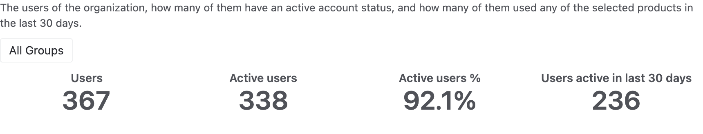
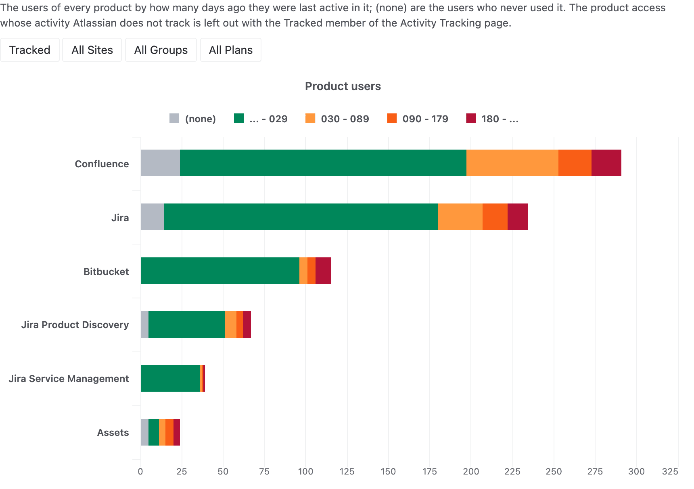
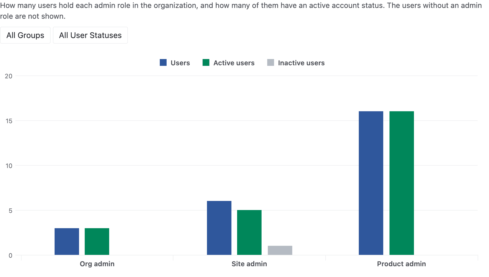
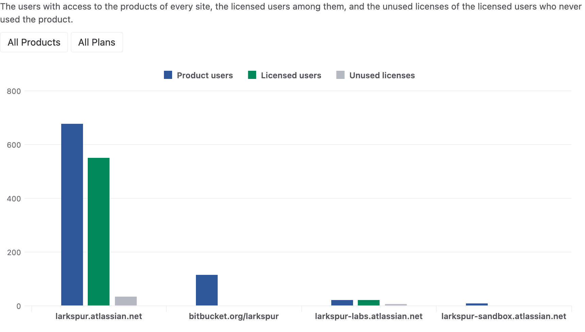
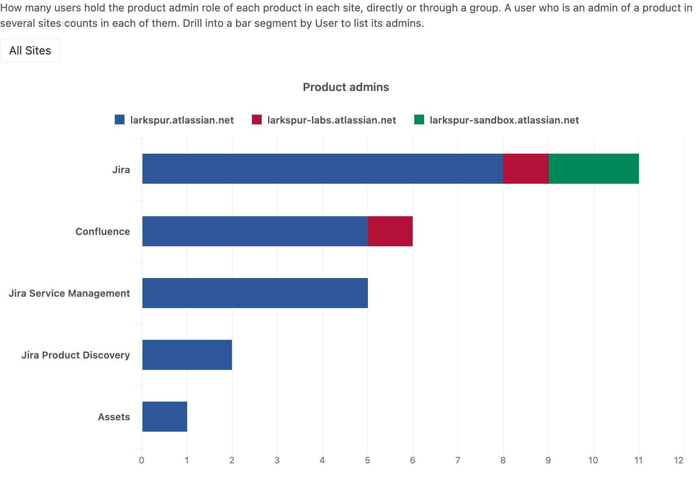
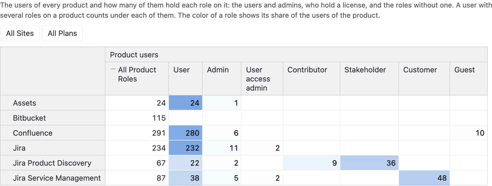
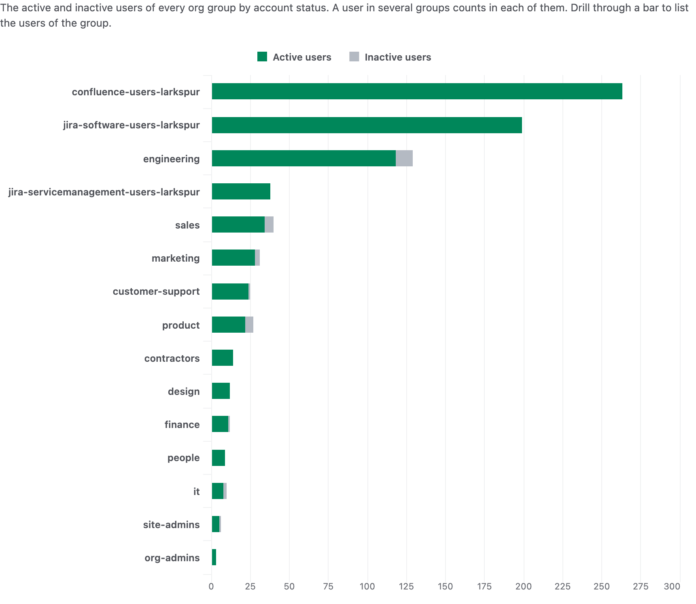

# Atlassian user and license analytics

Analyze the users, admin roles, product access and license usage of your Atlassian organization in eazyBI.

- See how many users your organization has, how many of them are active, and who used a product in the
  last 30 days.
- Find the licensed users who never used a product, or who have not been active in it for months.
- Compare the product users, licensed users and unused licenses of every site and product.
- Review who holds the org, site and product admin roles, and the roles of the users on every product.
- Count the active and inactive users of every group, and by user profile attributes such as the
  department.

## Sample reports

### Users overview

The users of the organization, the active users and the users active in the last 30 days give the headline
numbers.

### User product activity

The users of every product by how many days ago they were last active in it, next to the users who never
used it.

### Users by admin role

The org admins, site admins and product admins of the organization by their account status.

### Product users by site

The product users, licensed users and unused licenses of every site show its license usage.

### Admins by product

The product admins of every product, stacked by the site they administer it in.

### Product users by product role

The users of every product by their role on it, from the licensed users and admins to the customers and
guests.

### Users by group

The active and inactive users of every org group.

