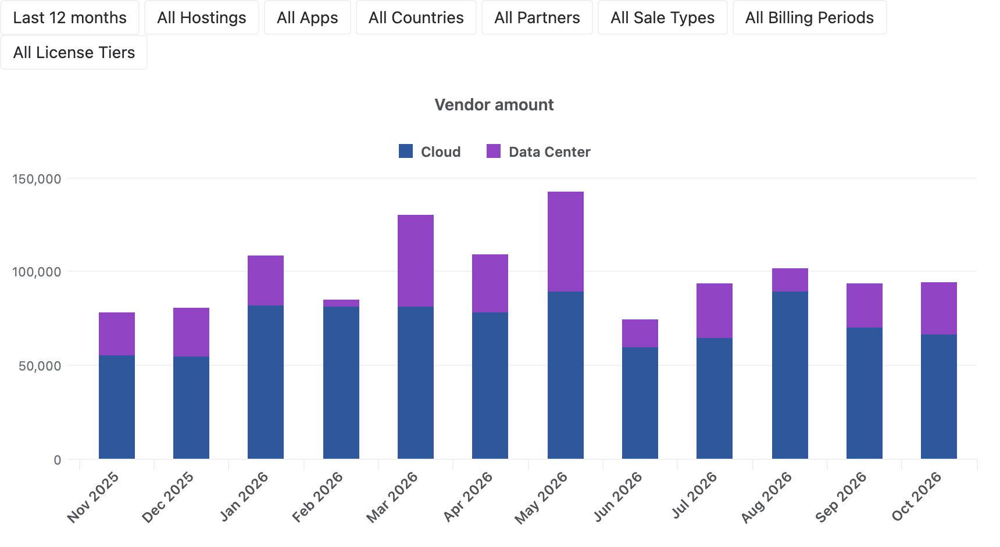
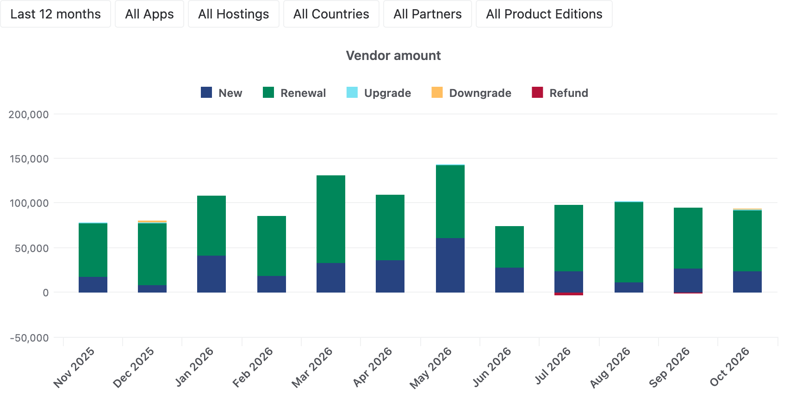
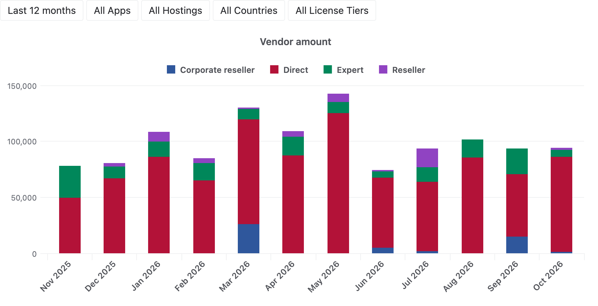
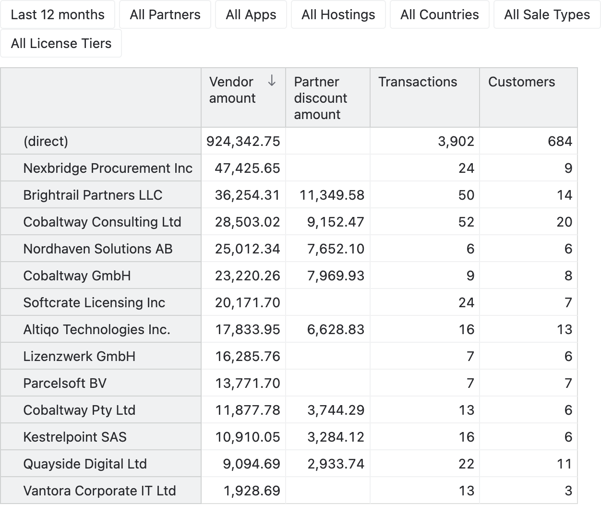
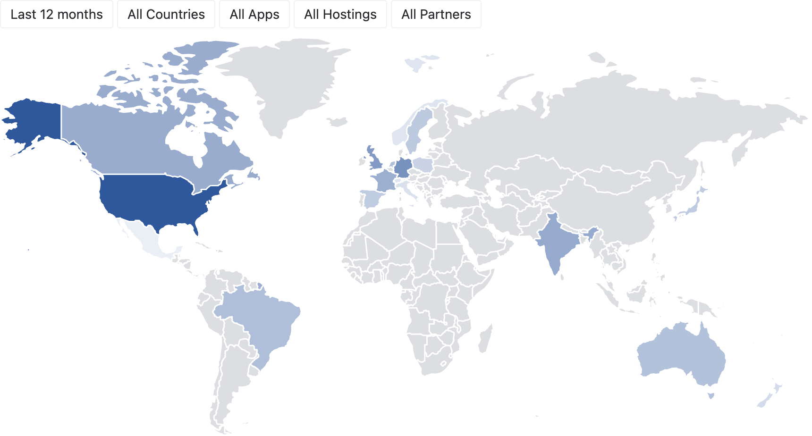
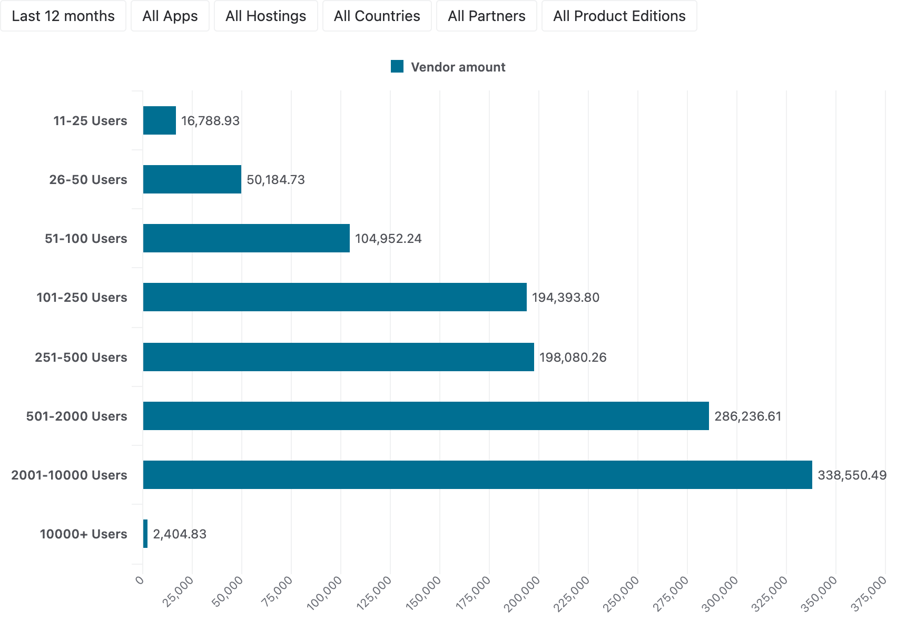
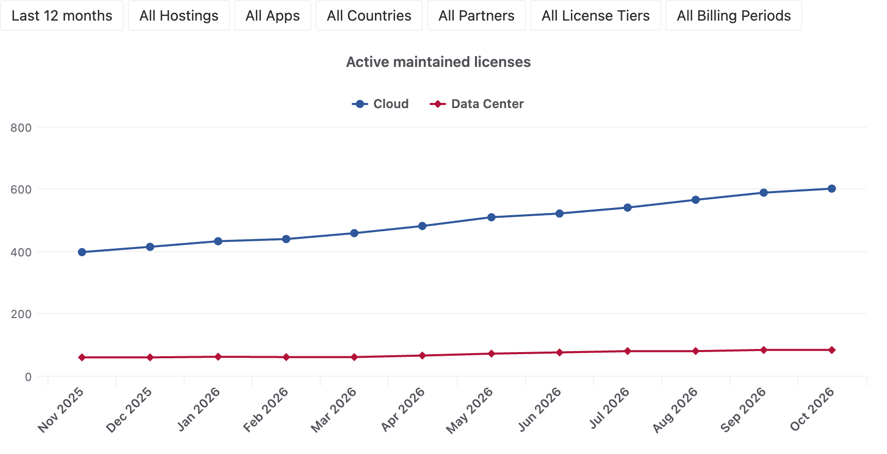
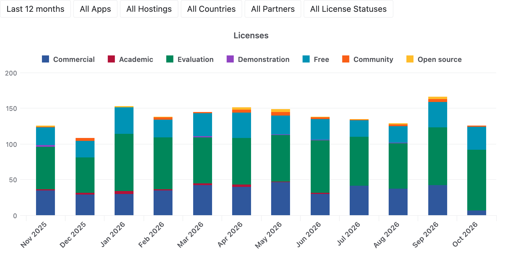
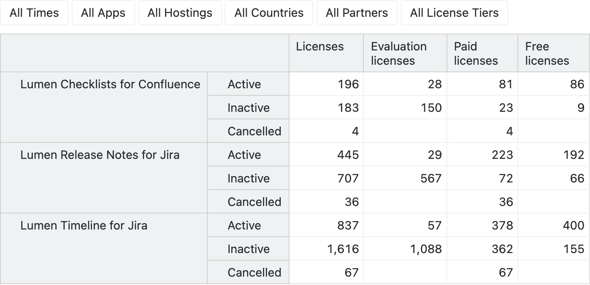

# Atlassian Marketplace sales analytics

Analyze the licenses and the sales transactions of your Atlassian Marketplace apps in eazyBI and see how your
Marketplace business is doing:

- Track the vendor amount over time, by app, hosting, sale type and billing period.
- See which share of the revenue the partners bring, and rank the partners by their sales and discounts.
- Find the countries and the customer sizes your revenue comes from.
- Follow the active maintained licenses and the new evaluations, commercial and free licenses month by month.
- List the latest sales with their customers, tiers and partners.

## Sample reports

### Sales by month and hosting

The vendor amount of every month by hosting shows how the cloud and the Data Center sales develop.

### Sales by month and sale type

The vendor amount of every month split into new sales, renewals, upgrades, downgrades and refunds shows where the
revenue comes from.

### Sales by month and partner type

The vendor amount of every month by partner type shows the share of the sales that the experts, the resellers and
the corporate resellers bring.

### Top partners

The vendor amount, partner discount, transactions and customers of every partner rank the partners of the last
12 months.

### Sales by country

The vendor amount of every customer country shows the markets of the last 12 months on a world map.

### Sales by user tier

The vendor amount of every user tier range shows which customer sizes bring the revenue.

### Active maintained licenses by month

The licenses with active maintenance at the end of every month show how the paying customer base grows on cloud and
Data Center.

### New licenses by month and type

The new licenses of every month by license type show the evaluations, the commercial and the free licenses that the
apps get.

### Licenses by app and status

The licenses of every app by status compare its active, inactive and cancelled evaluations, paid and free licenses.

