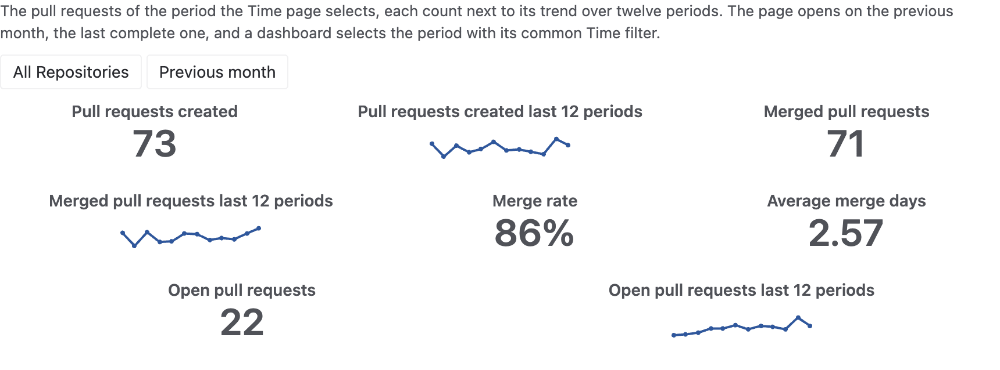
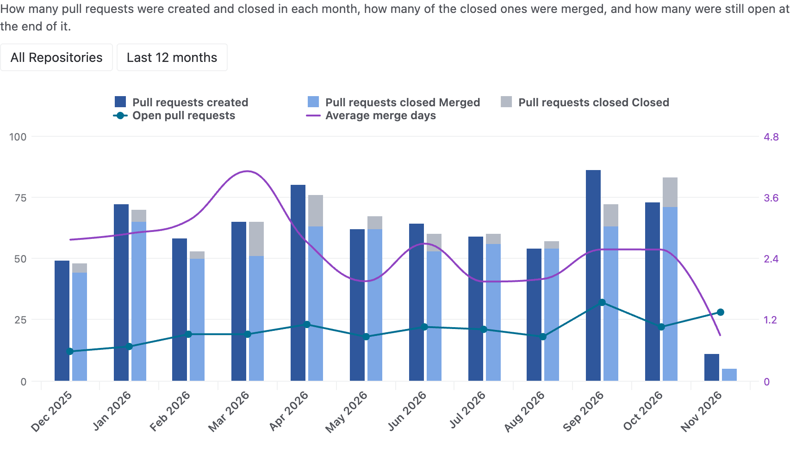
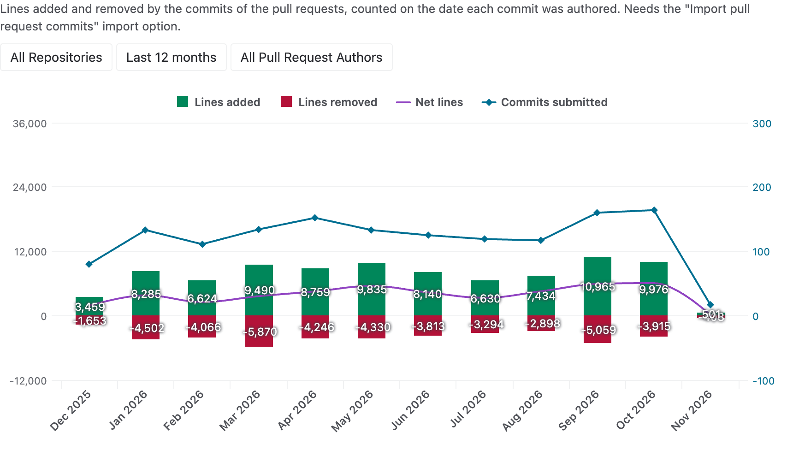
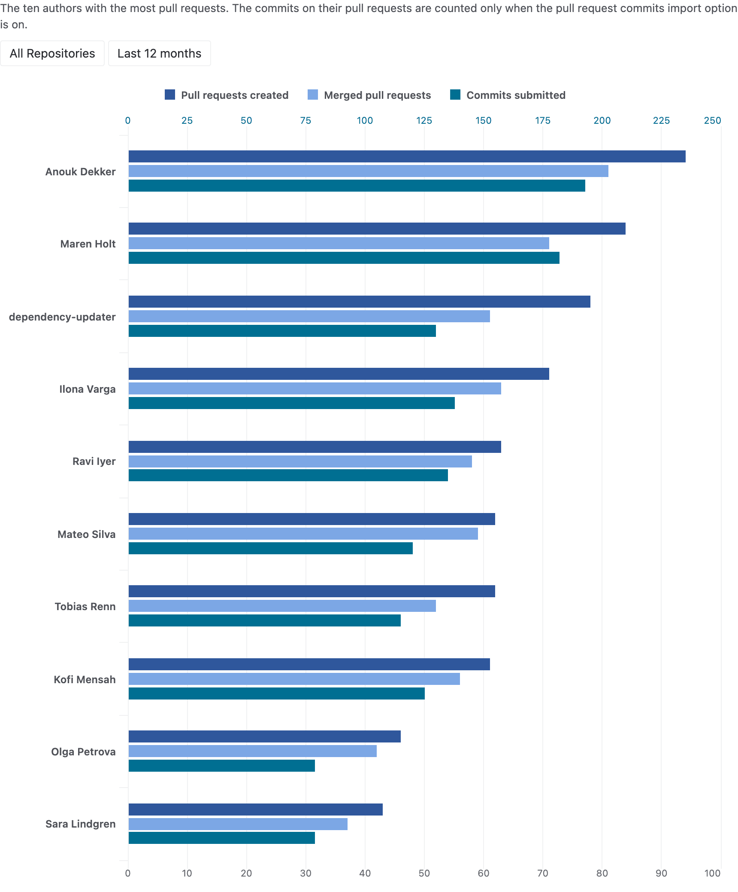
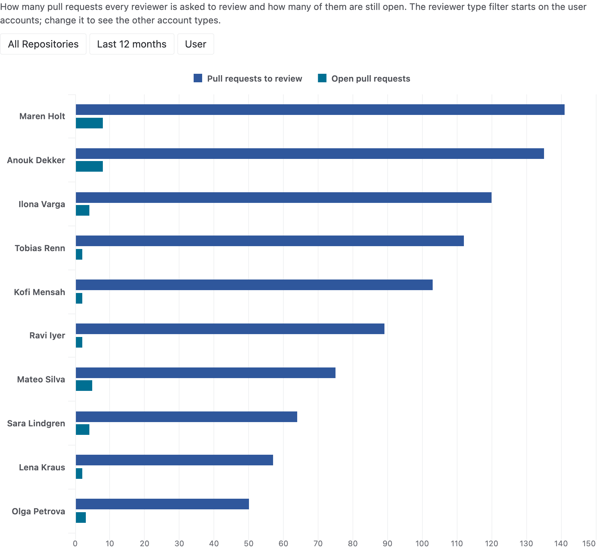
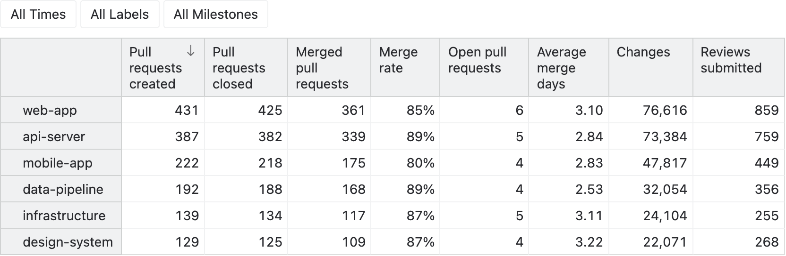
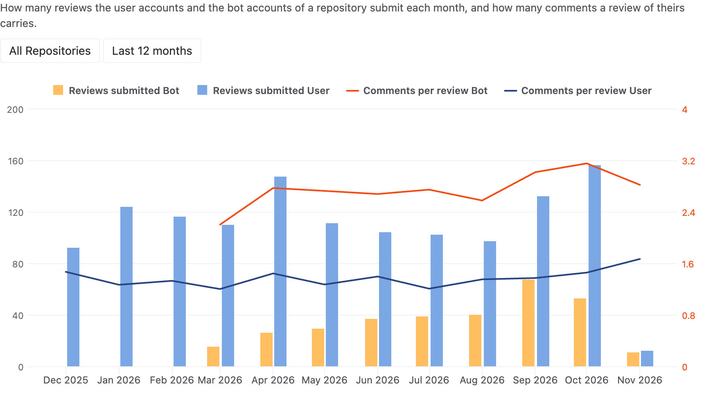
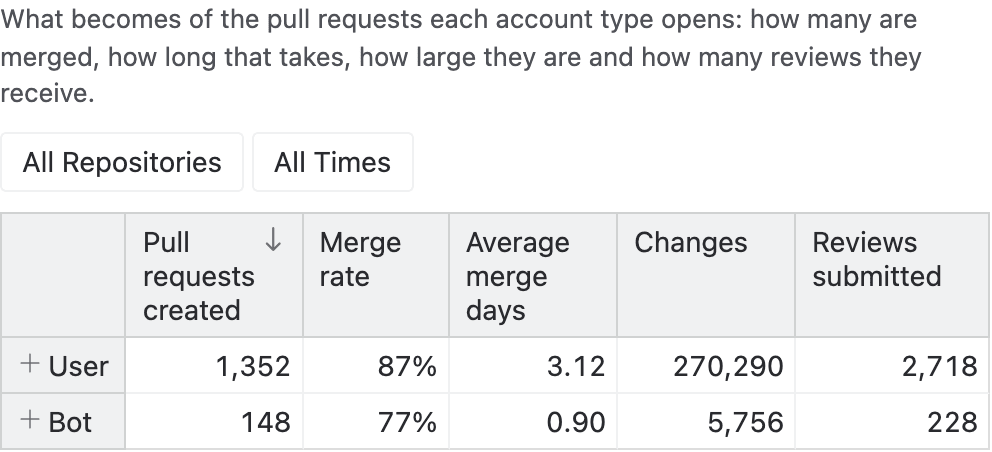

# GitHub pull request analytics

Analyze the pull requests of your GitHub repositories in eazyBI and see how fast your team reviews and merges them.

- Track the created, merged and closed pull requests over time, by repository, author, label and milestone.
- Measure the merge times and the time a pull request waits for a review, for changes and for its merge.
- Compare the review load of the reviewers and find the pull requests that have been open for the longest time.
- Follow the lines added and removed by the commits of every month.
- See how much of the reviewing and the authoring the bot accounts do next to the people of the team.

## Sample reports

### Pull requests overview

The created, merged and open pull requests of the previous month, each next to its trend over twelve months, with the
merge rate and the merge time.

### Pull requests created and closed over time

The created, merged and closed pull requests of every month show whether the reviews keep up with the new pull
requests.

### Code changes over time

The lines added and removed by the commits of every month show when the work on the pull requests happened.

### Pull requests by author

The created and merged pull requests and the commits of the ten most active authors compare their contributions.

### Review load by reviewer

The pull requests every reviewer is asked to review, and how many of them are still open, show how the reviews are
shared in the team.

### Pull requests by repository

The created, closed and merged pull requests, the merge rate and time, the code changes and the reviews of every
repository give the headline numbers of all time.

### Review activity by account type

The reviews that the user and the bot accounts submit every month, and the comments a review of theirs carries,
show how much of the reviewing the bots do.

### Pull request outcomes by author type

The merge rate, the merge time, the size and the reviews of the pull requests opened by the user and the bot
accounts show what becomes of the pull requests of each.

