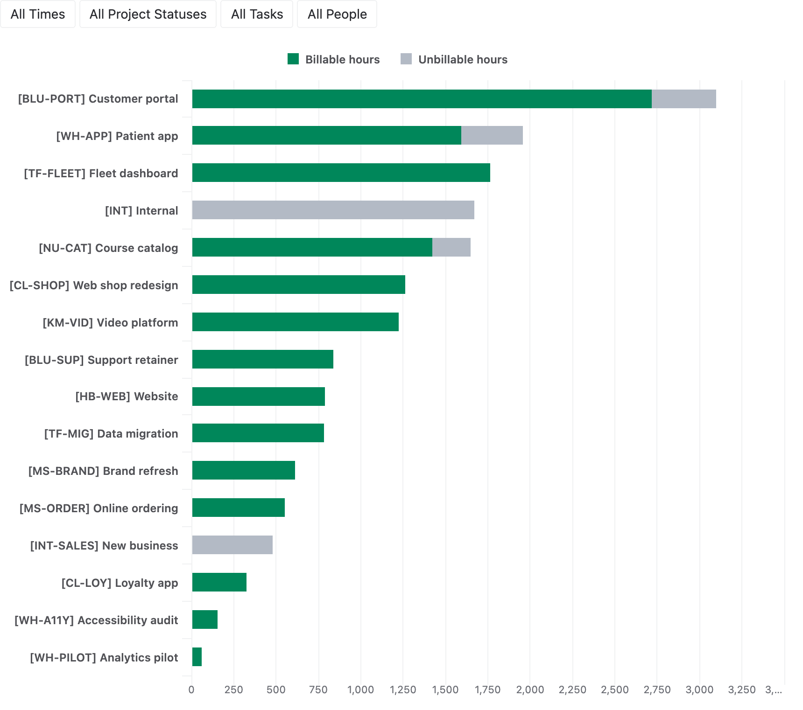
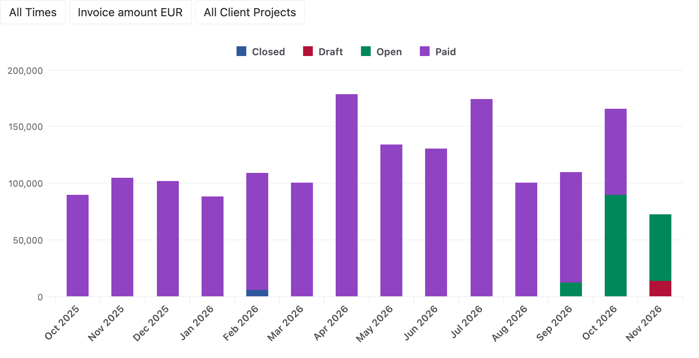
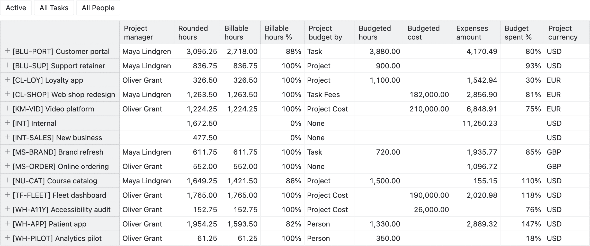
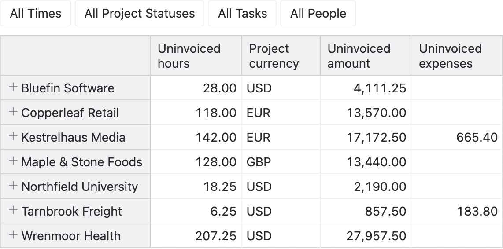
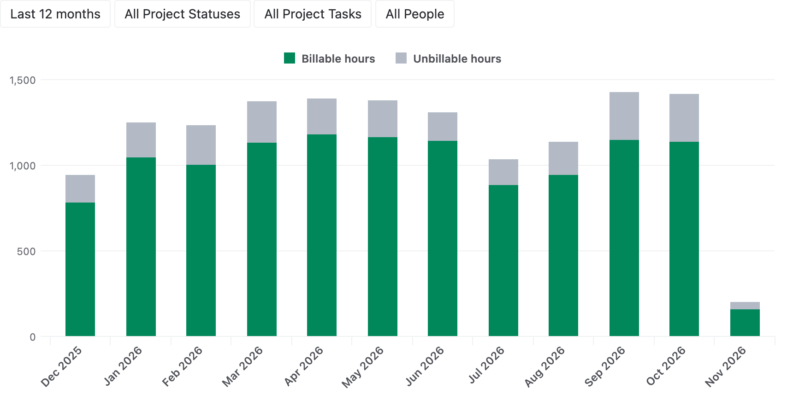
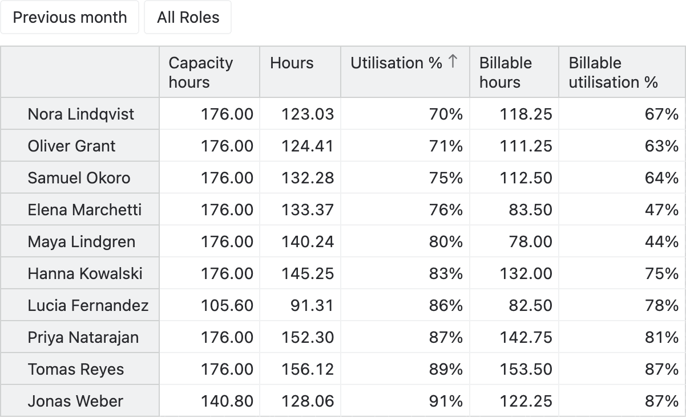
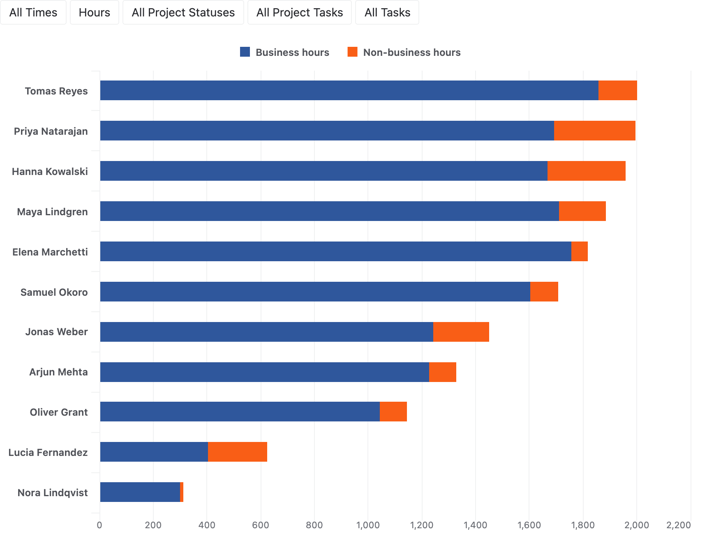
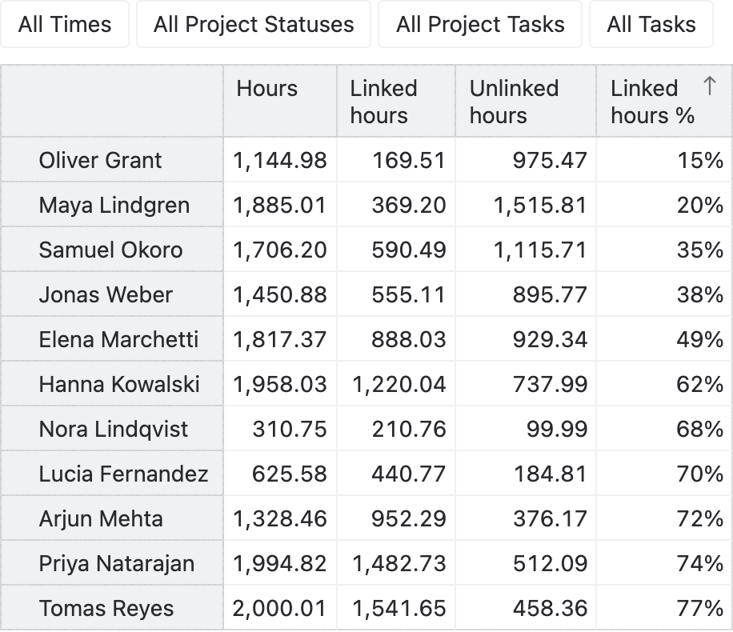
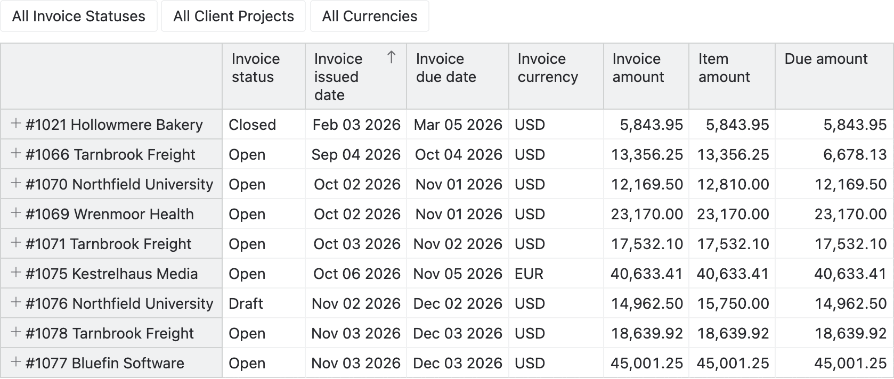

# Harvest time and billing analytics

Analyze the tracked hours, project budgets, team utilisation and invoices of your Harvest account in eazyBI.

- Compare the billable and unbillable hours of every client, project, task and person, month by month.
- Follow the budgets of the running projects and see which ones are about to run over.
- Measure how much of the weekly capacity of every person is used, and how much of it is billable.
- See who works outside the business hours and on non-working days.
- Find out how much of the time is tracked on Jira issues, Trello cards, GitHub issues and Asana tasks.
- List the billable work and expenses that are not invoiced yet, and the invoices that are not paid.
- Report the amounts of every client currency in EUR and USD as well.

## Sample reports

### Billable vs unbillable hours by project

The billable and unbillable hours of every project show where the time of the team goes and how much of it can be
billed.

### Invoice amounts by month

The invoiced amounts of every month in EUR by invoice status show the revenue and the part of it that is still open.

### Active projects status

The managers, hours, budgets and budget spent of the running projects show which projects are about to run over
their budget.

### Uninvoiced hours and expenses

The billable hours, amounts and expenses of every client that are not invoiced yet show what is still to be billed.

### Billable and unbillable hours by month

The billable and unbillable hours of every month of the last 12 months show how the workload and its billable share
develop.

### Utilisation by person

The capacity, hours and utilisation of every person in the previous month show who has time to spare and who is
fully booked.

### Business and non-business hours by person

The hours of every person within and outside the business hours show who works early, late or on non-working days.

### Linked hours by person

The hours of every person that are tracked on a Jira issue, a Trello card or another linked item, and their share,
show whose time can be traced to the work items.

### Unpaid invoices

The open, draft and written-off invoices with their due dates and the amounts still due list what the clients have
not paid yet.

