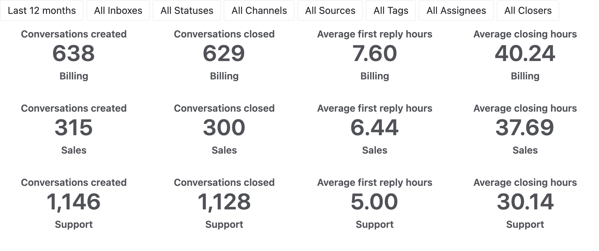
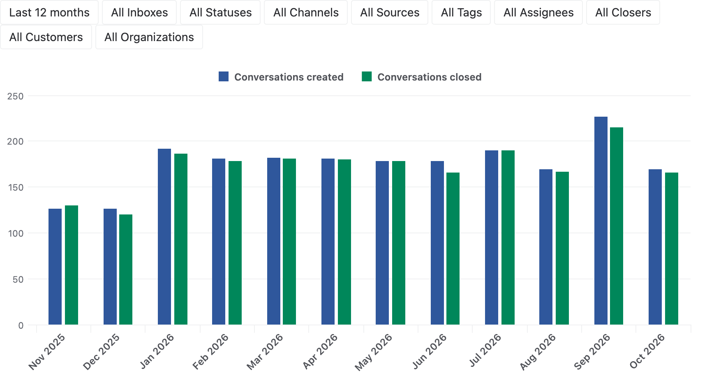
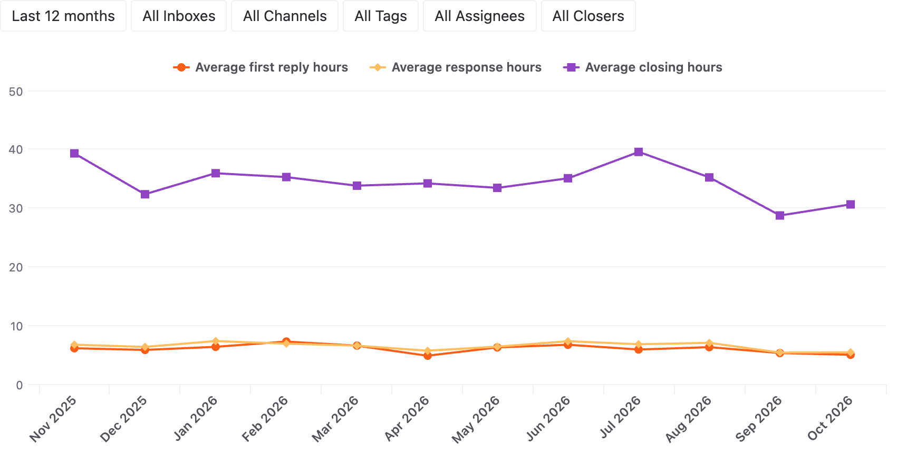
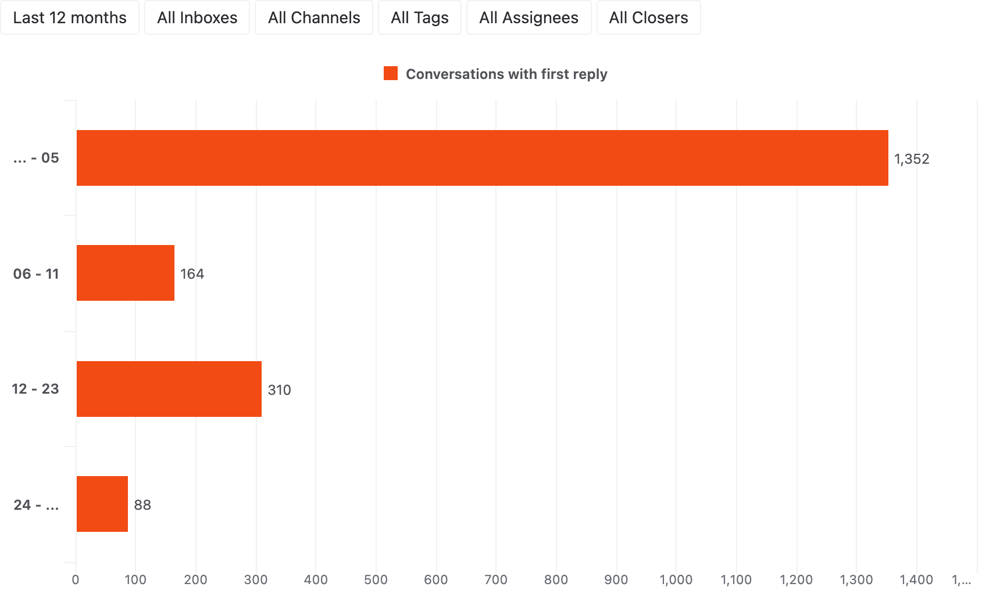
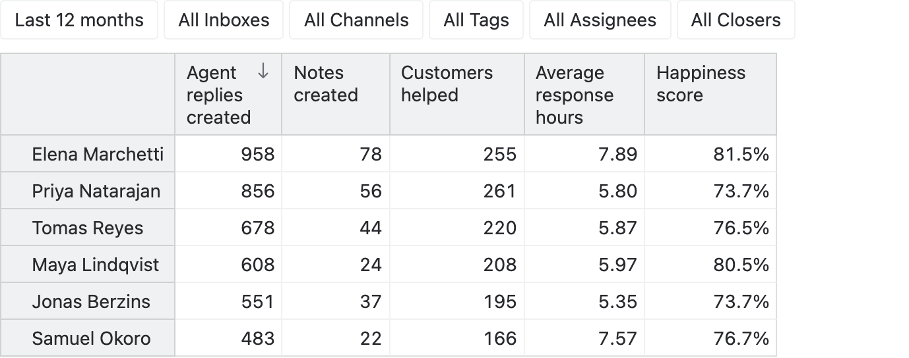
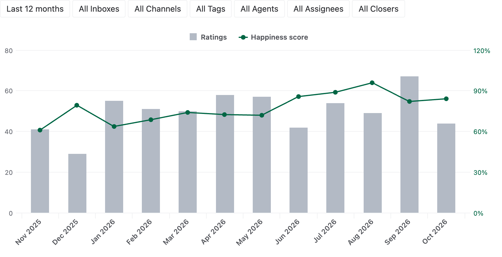

# Help Scout support analytics

Analyze the conversations of your Help Scout inboxes in eazyBI and see how your support team is doing:

- Track the created and closed conversations over time, by inbox, channel, tag and customer.
- Measure the first reply, response and resolution times, and see how they change month by month.
- Compare the workload of the agents — their replies, notes and the customers they helped.
- Follow customer happiness from the satisfaction ratings of the agent replies.
- Find when your customers write in, and how many messages it takes to close a conversation.

## Sample reports

### Conversations by inbox

The created and closed conversations and the average first reply and closing hours of every inbox give the headline
numbers of the last 12 months.

### Conversations over time

The created and closed conversations of every month show whether the team keeps up with the incoming volume.

### Response and resolution times

The average first reply, response and closing times of every month show how fast the customers get their answers.

### First reply time distribution

The first reply time distribution shows how many conversations were answered within 6, 12 and 24 hours.

### Replies by agent

The replies, notes, helped customers, response time and happiness score of every agent compare the work of the team.

### Happiness over time

The satisfaction ratings and the happiness score of every month show how the customers feel about the answers.

