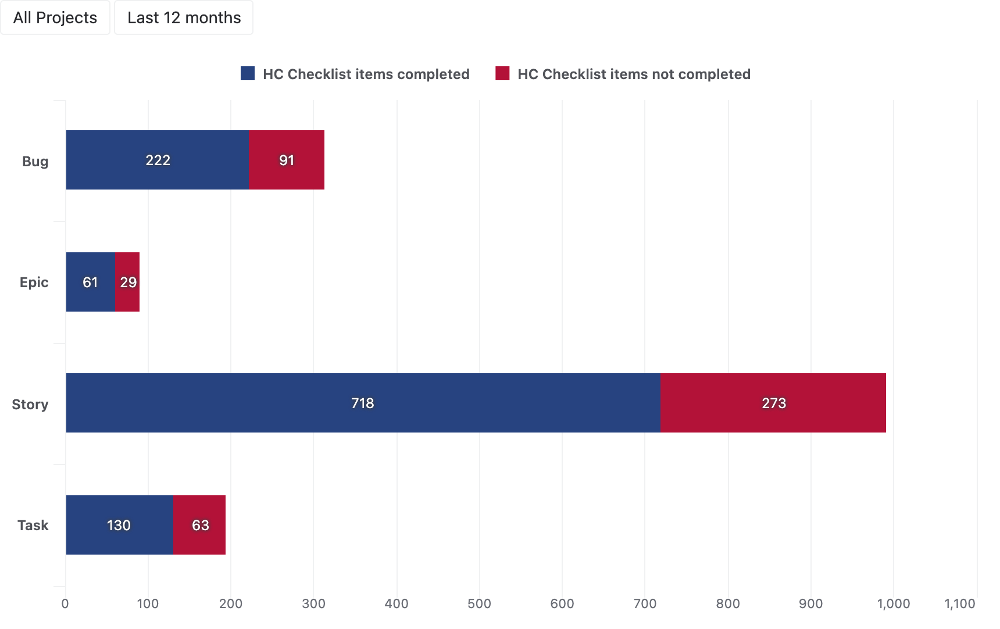
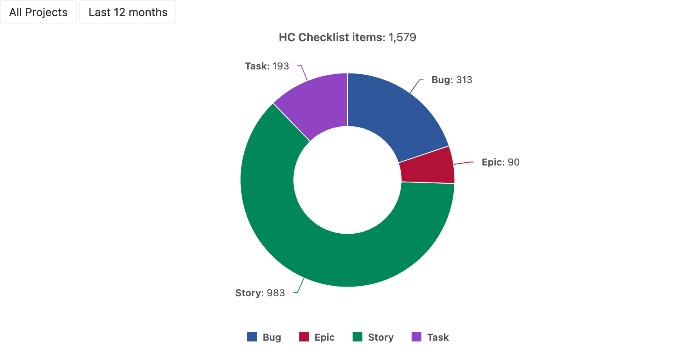
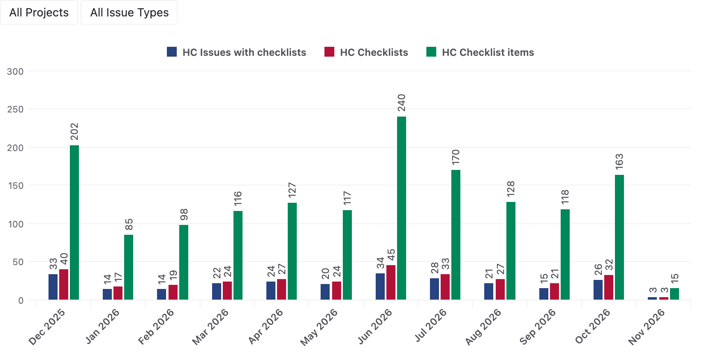
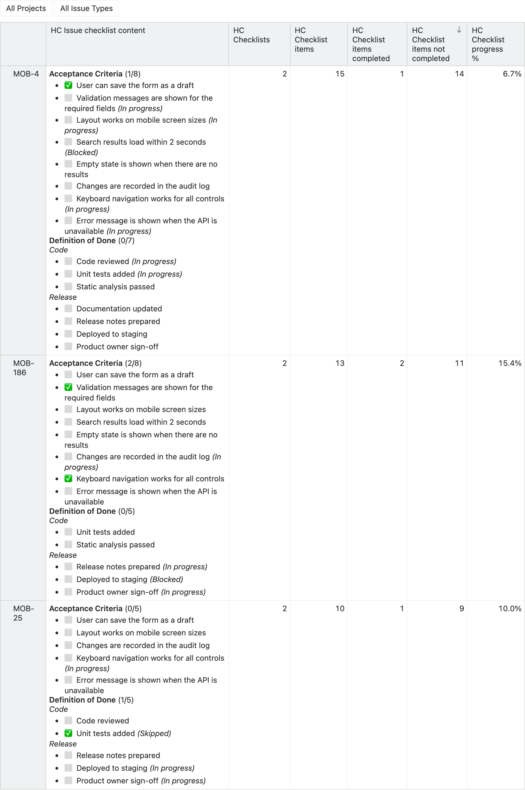

# Jira checklist analytics

Analyze Checklists for Jira by HeroCoders in eazyBI reports, together with the Jira issues they belong to.

- Follow the checklist progress of your issues, epics, sprints and versions.
- Track the checklist items completed and reopened over time, dated by the actual completion and reopening.
- Compare the checklists, their sections and items by project, assignee or any other Jira field.
- Find the items which were reopened after they were done, and the issues with open items.
- See the checklists of an issue in a report, with the status of every item and its links.

## Sample reports

### Checklist item completion by issue type

The completed and not completed checklist items of every issue type show where the checklist work is still open.

### Checklist items by issue type

The share of the checklist items of every issue type shows which work items carry the most checklist steps.

### Checklists over time

The issues with checklists, the checklists and their items of every month show how the checklist use grows.

### Work items with checklists

The checklists of the work items in progress with the most open items, with the status of each item and the
headers, next to their checklist progress.

