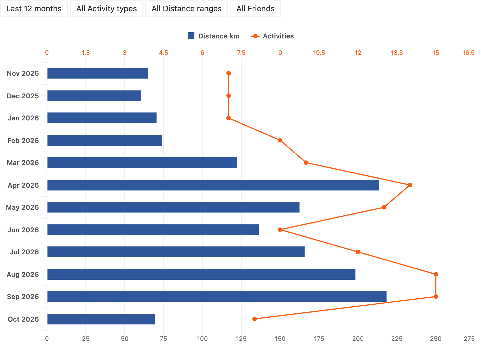
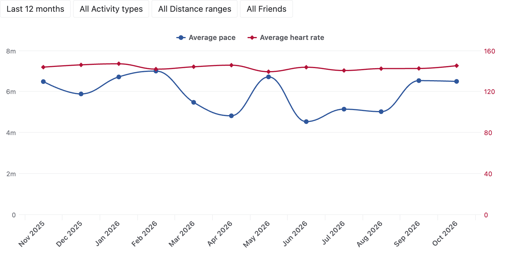
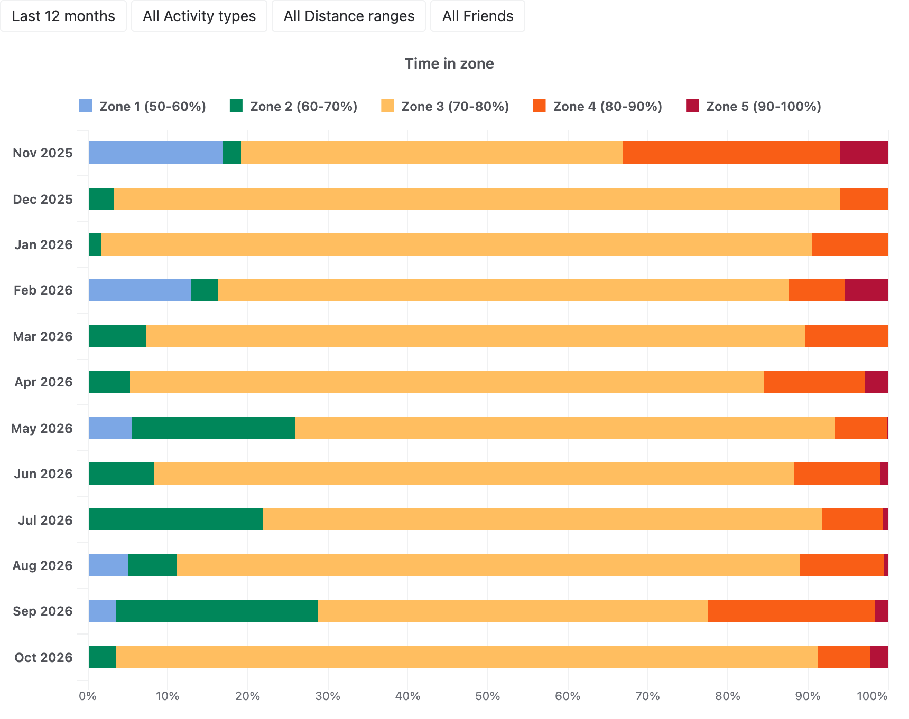
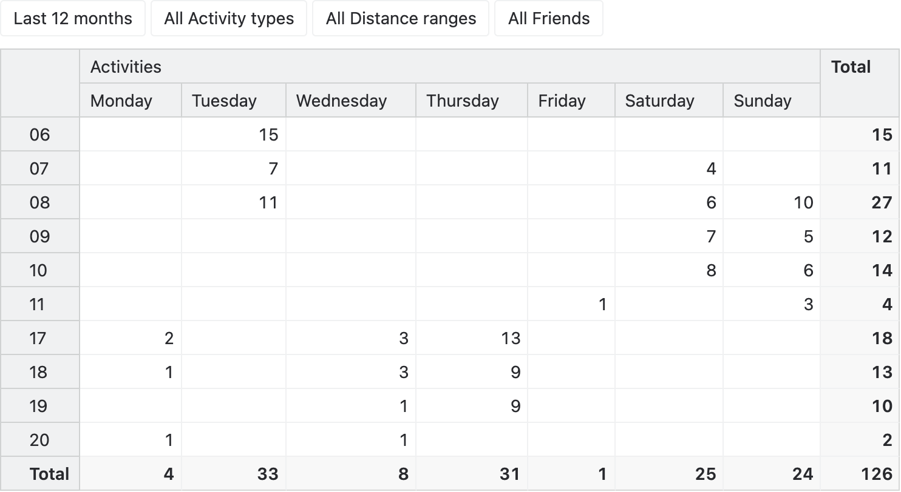
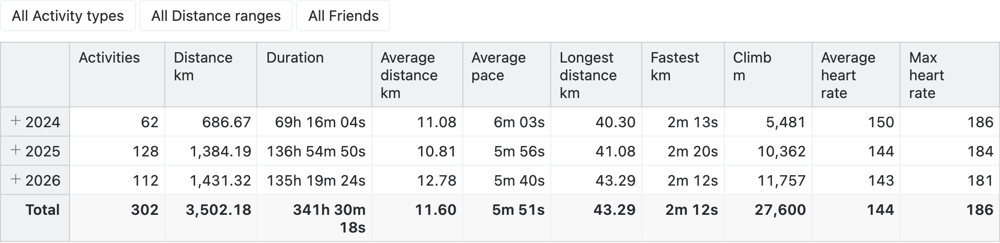

# Runkeeper training analytics

Analyze all your Runkeeper activities in eazyBI and see how your training develops over the years:

- Track your distance and the number of activities month by month, by activity type and distance range.
- Follow your average pace and heart rate, and see how you get faster at the same effort.
- See how much time you spend in each heart rate zone, from easy runs to races.
- Find your training habits — which days and hours you train, and with which friends.
- Compare the years by distance, duration, longest activity, fastest kilometer and climb.
- Drill into the pace of every kilometer of every activity from its GPS track.

## Sample reports

### Distance by month

The distance and the number of activities of every month show how the training volume changes with the seasons.

### Pace and heart rate by month

The average pace and heart rate of every month show whether you get faster at the same effort.

### Time in heart rate zones by month

The share of the time in each heart rate zone shows how much of the training is easy and how much is hard.

### Activities by hour and week day

The activities by the hour and the day of the week when they started show your training routine.

### Yearly summary

The activities, distance, duration, pace, longest and fastest efforts, climb and heart rate of every year compare the years
of your training history.

